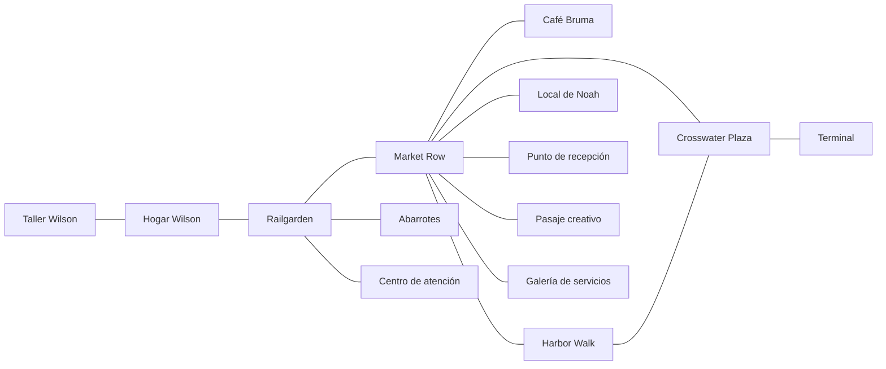

# Meridian Bay — escala urbana y distribución preliminar del mapa

**Versión:** MB-CITY-SCALE-PLAN-20261112-A · **Estado:** propuesta cartográfica revisable, NO canon narrativo ni medida topográfica.
**Catálogo numérico y posiciones:** [MERIDIAN_BAY_CITY_SCALE_PLAN_20261112.json](MERIDIAN_BAY_CITY_SCALE_PLAN_20261112.json). **Lógica de consulta:** `tools/meridian_bay_scale_plan.mjs`.

## 1. Objetivo

Meridian Bay debe existir como ciudad **antes** de que Jack la conozca, y la geografía debe conservar continuidad entre escenas. Actualmente el canon incluye una ciudad costera con puerto, negocios, viviendas, transporte público, ocho ubicaciones `LOC-*` iniciales y ocho enlaces de ruta bidireccionales. El catálogo de diseño previo aporta otros seis establecimientos: dos en Railgarden y cuatro en Market Row. **Nada de lo siguiente confirma una visita ni avanza el turno 9.**

La intención no es imponer un reloj exacto, sino disponer de un armazón que haga creíbles los recorridos, futuras edificaciones y decisiones de los NPC. Por eso se fija una **escala de referencia editable**, no una lista rígida de calles y kilómetros.

## 2. Extensión hipotética — NO una dimensión ya confirmada

Para el dibujo de trabajo se usa un lienzo de **100 × 80 celdas**, a razón de **100 metros nominales por celda**, equivalente a **10 km de ancho × 8 km de alto** (**80 km² de recuadro gráfico**).

**Importante:** esos 80 km² NO son un cálculo del área municipal ni del suelo urbanizado; el rectángulo incluye territorios y agua todavía sin cartografiar. Tampoco hay coordenadas GPS, orientación cardinal aprobada, población, fecha o país confirmados. La escala puede revisarse en una versión posterior sin reescribir acciones ya narradas. Los puntos numéricos son **representaciones aproximadas de posición**, con tolerancias explícitas, no mediciones de calles o límites exactos.

Como referencia, la estructura activa de la novela se concentra en el **núcleo central de estudio** del lienzo (celdas X 40–75, Y 31–54: aproximadamente 3,5 km × 2,3 km de área de trabajo). El resto del lienzo queda como reserva para diseñar después, **sin inventar distritos habitados, vías o servicios que aún no existen en el canon**.

## 3. Referencias de ubicación aproximadas (sin cardinales confirmados)

| Área/edificio ya conocido | Punto de referencia (X, Y) | Uso del mapa |
| --- | --- | --- |
| Hogar y taller Wilson | (46,3; 44,5) | Mismo edificio. El taller es interior del hogar, no una calle aparte. |
| Railgarden | (48; 44) | Referencia del barrio residencial; los abarrotes y la clínica pertenecen a su tejido. |
| Market Row | (58; 43) | Corredor comercial; aquí se ubican Noah, entregas, pasaje cultural, galería de servicios y Café Bruma. |
| Crosswater Plaza | (65; 42) | Zona pública conectada con Market Row, terminal y Harbor Walk. |
| Crosswater Terminal | (66; 42) | Instalación de transporte contigua a la plaza, sin andenes exactos. |
| Harbor Walk | (71; 37) | Paseo público orientado hacia el litoral y la actividad portuaria visible. |

Los valores son **coordenadas de una cuadrícula ficticia**, no latitud ni longitud. Aproximaciones como «el corredor Market Row–Crosswater atraviesa unas siete celdas de referencia» no equivalen a una ruta real de 700 metros. Las calles pueden curvarse, tener cruces, zonas de acceso o interrupciones todavía no cartografiadas. Por tanto, el sistema devuelve **minutos de desplazamiento desconocidos** y no fija una duración absoluta.

Los seis establecimientos preconstruidos también tienen puntos individuales de referencia en el JSON, aproximadamente alrededor de su ancla de barrio. Su entrada cartográfica sigue conectada **solo con el ancla `LOC-*` de su distrito**, sin habilitar teletransporte de una tienda a otra.

## 4. Áreas de estudio del núcleo

| Zona | Recuadro de estudio nominal | Estado |
| --- | --- | --- |
| Railgarden | aprox. **1,0 × 1,4 km** | Área de trabajo, NO límite aprobado del barrio. |
| Market Row | aprox. **0,9 × 1,1 km** | Corredor comercial aproximado, sin anchura vial confirmada. |
| Crosswater Plaza | aprox. **0,6 × 0,6 km** | Entorno de la plaza, no tamaño físico de la plaza. |
| Crosswater Terminal | aprox. **0,5 × 0,5 km** | Área de estudio del terminal, no el área construida del edificio. |
| Harbor Walk | aprox. **0,9 × 1,0 km** | Franja conceptual del paseo, no perímetro portuario. |

**Recuadro de estudio** significa un espacio para desarrollar la geografía; no confirma que el barrio o edificio ocupe físicamente todas esas celdas. Los recuadros de Crosswater y el terminal pueden superponerse en el dibujo porque son instalaciones contiguas, no barrios jurídicamente separados.

Áreas de reserva adicionales (sin `LOC-*`, sin acceso jugable ni NPC nuevos): expansión oeste, interior norte, reserva sur y borde del agua/puerto por estudiar. Se dejan abiertas para evitar que las primeras decisiones de escala obliguen a inventar una ciudad completa de golpe.

## 5. Grafo de rutas canónicas que sigue vigente

**El diagrama representa conectividad, NO longitudes ni orientación geográfica.** Los primeros ocho enlaces provienen del estado narrativo; los otros seis son los accesos de diseño de `game/MERIDIAN_BAY_PREBUILT.json`. El dibujo no crea callejones ni conexiones adicionales. Los límites privados, los recorridos escolares y el acceso al puerto industrial no se inventan.

La herramienta `previewMeridianBayPlanningSpan` permite comparar dos puntos **ya alcanzables** por el grafo usando una banda orientativa de separación en línea recta. Por ejemplo, las referencias Railgarden–Market Row quedan aproximadamente entre **0,4 y 1,6 km de separación conceptual**, después de aplicar las incertidumbres cartográficas. Esta banda **NO es distancia de la ruta, no es una duración de caminata y no reemplaza los estimados narrativos anteriores**. Si el lugar no está establecido o el grafo no lo conecta, la función devuelve `null`.

## 6. Condiciones para continuar el mapa

1. **No confundir arquitectura previa con conocimiento de Jack.** El narrador puede consultar el diseño; Jack aprende nombres y caminos mediante causas dentro de la ficción.
2. **No dar por acabados los interiores.** Si algún edificio se vuelve relevante, conservar fachadas, accesos y funciones ya fijadas antes de detallar su distribución interior.
3. **No derivar hechos sociales de coordenadas.** Un comercio cercano no prueba que un NPC lo visite; una ruta posible no prueba que alguien viajó; no hay turnos autónomos entre mensajes.
4. **No imponer orientación cardinal ni costa ficticia como certeza.** La posición relativa del paseo junto al puerto es coherente con las conexiones actuales, pero la línea costera, muelles, bahía real y accesos restringidos siguen pendientes.
5. **Mantener la posibilidad de expansión.** Una vez revisados los recuadros de estudio, diseñar con cuidado los ejes peatonales y calles principales de Railgarden y Market Row, antes de dibujar cada edificio.
6. **Persistencia:** cualquier futura incorporación al estado canónico requiere integración editorial y una transacción validada. Nunca inferir que el mapa técnico produce un nuevo turno de Jack.

## 7. Estado de implementación y verificación

Este incremento registra una escala útil y revisable para la ciudad, cinco áreas de estudio, cinco reservas/regiones de planificación y catorce puntos de referencia (`8 LOC` anteriores + `6 LOC` de diseño). Ver `tests/meridian_bay_city_scale.test.mjs` para las pruebas de límites, unicidad, relaciones de barrio y ausencia de rutas inventadas.

**Lo que todavía falta para llamar al mapa «completo»:** perímetro físico verdadero, descripción de los bordes geográficos, trazado de calles/puentes, jerarquía vial, dimensiones de manzanas, edificios de fondo, distribución de población, acceso escolar, infraestructura portuaria y expansión de servicios. La prioridad siguiente son **corredores caminables y manzanas de Railgarden y Market Row**, sin inventar la escuela de Elena ni recorridos secundarios no confirmados.

Los archivos de `CH-000` deben permanecer idénticos a `work/chat-narrative-foundation`. Ningún cambio de la geometría de diseño puede reescribir la escena del turno 9 o activar Aster.
