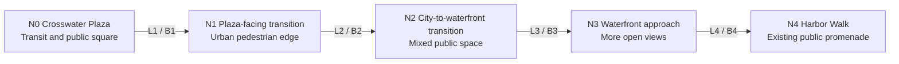

# Meridian Bay — Crosswater Plaza → Harbor Walk: one detailed waterfront corridor

**Status:** DETAILED DRAFT ONLY — NOT CANONICAL STREET GEOMETRY.  
**Owners' mapping method:** Connect two established places → develop every intervening part → verify → move to the next pair. No jump to another district before this section's QA.

## Evidence and dependencies

This section continues after the completed *draft* Railgarden → Market Row detail (PR #38) and Market Row → Crosswater Plaza detail (PR #40). It reuses the existing, unmerged harbor-sketch/evidence files from the separate earlier **unpublished Harbor growth branch**; it does not move or merge those branches.

- [Existing Crosswater ↔ Harbor Walk outline](MERIDIAN_BAY_ROAD_WEB_SLICE3_20261116.json)
- [Source-linked waterfront evidence](MERIDIAN_BAY_WATERFRONT_STORY_EVIDENCE_20261116.json)
- [Four-part interior section data](MERIDIAN_BAY_CROSS_HARBOR_CORRIDOR_DETAIL_20261116.json)
- [Read-only verification](../../tools/meridian_bay_cross_harbor_corridor.mjs) and [regression tests](../../tests/meridian_bay_cross_harbor_corridor.test.mjs)

The saved starting locations describe **Crosswater Plaza** with a glass-fronted transit terminal and harbor visible between city buildings, and **Harbor Walk** as a public pedestrian waterfront route with views toward industrial and passenger port activity. The saved chapter also depicts port lights extending over dark water beyond the buildings. These references establish an **ordinary plausible view**, not geographic precision, road safety, or public entrance into secured port property.

## One corridor, four in-between areas

All points are **provisional** on the existing 100×80 design canvas: Crosswater `(65,42)`, then `(66.9,40.6)`, `(68.9,39.15)`, `(70.1,37.85)`, and Harbor Walk `(71,37)`. These are references for continuity in a story-world map, not measured streets or distances.

| Link | Candidate details between endpoints | Unverified constraints |
|---|---|---|
| L1 / B1 | Passenger/transit square transitions to ordinary public pedestrian frontage | Exact plaza curb/exit, legal crossing, store entrances |
| L2 / B2 | Urban frontages give way to more waterfront-oriented public space | Crossings, slopes, building positions, route accessibility |
| L3 / B3 | More open walking approach and potentially clearer perception of harbor activity | Shoreline, seawall, port perimeter and usable surfaces |
| L4 / B4 | Approach ends at the established Harbor Walk public promenade | Dock entrances, edge barriers, pavement, access to controlled facilities |

Each link has two relative sides of frontage, and every proposed point is contiguous with the previous and next point. The three intermediate `MB-CH-*` waypoint IDs are **geometry labels only**; they do not create `LOC-*` world places or spawn people.

The harbor is **visible**, but a precise, unobstructed line of sight is **not verified**. No dock, shipyard gate, road bridge, coastal border, road length, walking minutes or new named establishment is inserted by this map. Do not draw a new building which would invalidate the existing Crosswater harbor-view scene.

## Separate adjacency that must survive

`LOC-COMMERCIAL-DISTRICT ↔ LOC-HARBOR-WALK` (Market Row ↔ Harbor Walk) also exists in the saved graph. It is **not** the same road as the Crosswater Plaza route, and it must not be deleted or collapsed. Its in-between geometry remains a separate future section.

## Verification gate

The read-only checker requires both previously detailed corridors to validate, then checks that:
- the new five ordered geometry points exactly match the approved-to-review parent sketch;
- four contiguous links and four matching two-sided frontage bands exist;
- Crosswater Plaza and Harbor Walk are connected in the saved graph, with Market Row ↔ Harbor Walk intact;
- the recorded harbor-visibility description, waterfront access semantics and chapter port-light wording remain present in their original sources;
- the proposed corridor has no unregistered interior crossing with earlier drafted street sections;
- no route preview modifies saved state, NPCs, fictional time, player knowledge, or establishes unauthorized port entry.

**Next after successful review:** Detail **Market Row ↔ Harbor Walk directly**, as its own section. Only after the individual connections and their intermediate frontage are complete should the global Meridian Bay route/obstruction/massing audit begin. Until then the map is not a fully mapped playable city.

**Saved game untouched:** CH-000, turn 9, Day −29 morning.
