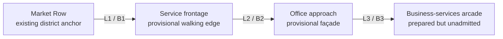

# Meridian Bay — Market Row business-services offices frontage

**Status:** Provisional three-span design; not admitted into the playable story world.

This is the final currently listed **undrawn prepared Market Row establishment approach**. The existing prepared catalog calls it `LOC-MARKET-BUSINESS-OFFICES`, a pedestrian-accessible services arcade with no known individual companies, staff or opening hours. Its catalog location is a planning reference only, not a confirmed building entrance or player discovery.

## Single corridor, detailed in between

On the *illustrative* planning grid, Market Row is at (58,43), the two intermediate points at (58.04,42.74) and (58.17,42.42), and the prepared business arcade at (58.3,42.1). The three segments have two-sided provisional frontage descriptions. The line fits within the existing city-core study region and was selected to avoid strict crossings with the prior sketches; this is not physical street surveying.

The approach's first segment retains ordinary Market Row commerce, the second introduces candidate small-business frontage, and the last proposes a pedestrian-facing services arcade. The design does not establish actual plot boundaries, tenants, traffic controls, disability access, exact doors or road length.

## Saved-state safeguards

No `game/`, `chapters/` or journal files change. The offices are in the **prepared Phase 1 catalog**, not Jack's saved canonical location graph. A public-facing site classification does not prove its doors are open now. No named companies, employees, clients, meetings, transactions, discoveries or interactions can be inferred.

The earlier delivery-point and Cultural Passage frontages remain separate, with their own links. The café's location and the terminal-light observation remain unaffected. Planning nodes cannot silently become playable places.

**Evidence:** [machine-readable plan](MERIDIAN_BAY_MARKET_BUSINESS_FRONTAGE_20261116.json), [read-only validator](../../tools/meridian_bay_market_business_frontage.mjs), [targeted tests](../../tests/meridian_bay_market_business_frontage.test.mjs).

## Acceptance and next phase

Execute targeted and full JavaScript/Python/checkpoint regressions. Only after verified tests should the **separate seeded-core audit** inspect every known connection, remaining frontages, duplicate routes, sketch crossings, physical uncertainty, access and story-line-of-sight constraints.

Completing this *prepared-site list* would not complete the full Meridian Bay city. Further neighborhoods, institutions, city bounds and physical roadway data remain beyond the seeded-core evidence.
