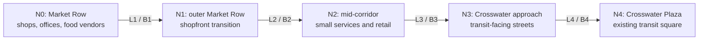

# Meridian Bay — Market Row to Crosswater Plaza: detailed single corridor

**Status:** DETAILED DRAFT / NOT SAVED WORLD CANON / NOT OPEN FOR LIVE PLAYER NAVIGATION.

This section follows the owner's exact order: **connect two existing locations → design what lies in between them → verify → only then begin the next section**. It is **not** a citywide roadmap, and it does not replace or reconfigure the earlier Railgarden–Market Row detailed corridor.

## Source and branch reconciliation

- Existing story and graph: `chapters/CH-000.transcript.json`, `game/STATE.json`, `game/STARTING_LOCATIONS.md`.
- Previous detailed section: [Railgarden–Market Row detail](MERIDIAN_BAY_RAILGARDEN_MARKET_CORRIDOR_DETAIL.md), maintained intact.
- Originally sketched connector: PR #36 / [Slice 2](MERIDIAN_BAY_ROAD_WEB_SLICE2.md). Its four candidate polyline intervals were copied **unchanged** into this development branch after the independently reviewed PR #38, because both were siblings of PR #34.
- Current detailed data: [JSON section plan](MERIDIAN_BAY_MARKET_CROSS_CORRIDOR_DETAIL_20261116.json), with [read-only validator](../../tools/meridian_bay_market_cross_corridor.mjs) and [tests](../../tests/meridian_bay_market_cross_corridor.test.mjs).

The copied connector is a dependency, not a second canonical city map; PR #36 itself remains a separate draft and should be reconciled during integration rather than merged twice.

## The route and its intermediate areas

The ordered line is the existing `MB-WEB-007` draft: Market Row `(58,43)` → `(59.8,42.6)` → `(62.2,42.3)` → `(64,42.1)` → Crosswater Plaza `(65,42)`, all on a **reversible illustrative 100×80 drafting canvas**, not surveyed coordinates. The endpoints represent district reference areas, not exact physical road junctions.

| Intermediate link | Proposed surroundings (two-sided frontage) | Must remain unresolved |
|---|---|---|
| L1: Market Row → outer shops | Small commercial frontage on both sides; separate Café Bruma side connection remains untouched | Café entrance street/corner and storefront alignment |
| L2: outer shops → midpoint | Mixed offices, retail and ordinary service activity; walking frontage concept | Individual shops, delivery entrances, access rights, traffic |
| L3: midpoint → transit approach | More transit-oriented small business frontage and growing pedestrian use | Crosswalks, exact widths, building positions and heights |
| L4: approach → Crosswater Plaza | City shopfronts meeting an existing busy public transit plaza | Plaza curb, terminal gates, bus/rail platform access and travel minutes |

The design cannot place a particular NPC at a point, guarantee a shop is open, assign a new address, infer a named street, or grant a new road shortcut.

## Saved-story continuity

CH-000 establishes that Jack moved from Crosswater Plaza **toward Market Row**, found **Café Bruma on a corner**, and could perceive some **glow from the transit terminal** near the café. This detail stage preserves all three facts while leaving exact door location, road sightline, building massing and light reflections undecided. Do **not** install a new building barrier contradicting the remembered light, or claim a direct unobstructed ray has been physically proven.

The reverse trip Market Row → Crosswater Plaza is a map preview on the same proposed corridor, not an additional canonical Jack journey.

## Validation and progression gate

- Four connected micro-links and five points match `MB-WEB-007` **exactly**, without adding world `LOC-*` entities or new route graph edges.
- Each micro-link has an explicit two-sided frontage, a pedestrian concept, access caveats, and no invented travel minutes or traffic rules.
- Railgarden–Market Row's prior detail validator still passes and its saved files are not modified.
- The source-linked CH-000 facts remain present; terminal-light perception remains a **design constraint**, not a simulated or certified sightline.
- Missing canonical graph connections fail closed; previews never mutate game state, story, NPC locations, time, player knowledge or the journal.
- Run targeted, full Node.js and Python regressions, and saved-checkpoint validation before marking the *software draft* tested.

After review and tests, move **only then** to the next detailed corridor (Crosswater Plaza → Harbor Walk). Harbor shoreline, extra side streets and larger city routes wait until their own section. After all sections, do a distinct complete-city routing/visibility/obstacle review; do not pretend separate corridor diagrams form a certified full city.

**Checkpoint protected:** CH-000, turn 9, Day −29 morning. **No merge, narrative advance or game-state activation is implied by this file.**
