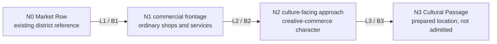

# Meridian Bay — Cultural Passage frontage in Market Row

**Status:** PROVISIONAL SITE ACCESS DRAWING; **NOT** admitted to Jack's playable world.

This review details **one location pair only**: the existing Market Row district and the already-authored but unadmitted **Cultural Passage**. It does not extend the city to a new district. It follows the owner-selected sequence: connect endpoints, design each part in between, verify, and then move to the next section.

**Sources:** the Phase 1 prepared public-site catalog, current location graph and the 100×80 provisional study grid. Cultural Passage is a separate prepared place from any similarly named trades passage. Its reference location is `(59,43.7)` relative to Market Row's `(58,43)`; the numbers are sketch anchors, not surveyed roads or street addresses.

## Three connected intermediate approach pieces

| Draft link | What lies between the endpoints | Not established |
|---|---|---|
| L1/B1 | Existing Market Row shop/office context becomes a local frontage approach. | Actual public crossings, lanes, storefront plots or named new shops. |
| L2/B2 | Transitional commercial façade with possible cultural/display-facing character. | Any programmed event, specific artwork, staff, interior exhibition or Noah-shop entrance. |
| L3/B3 | Candidate public-facing approach to the preauthored cultural site. | Door location, opening hours, accessibility, business operation or a character's visit. |

The geometry consists of four ordered provisional points, including two intermediate waypoints, and three candidate path links. Each link has a two-sided frontage description. This alternative lies close to Noah's shop but **does not relocate it** or claim a shared entrance.

## Story and simulation safeguards

The prepared catalog says the passage could host modest cultural trade and display. It **does not** establish Elena's presence, her artwork being exhibited, a crowd, an announced performance, a schedule or any NPC employment. None of those can be introduced by a map description.

The Cultural Passage is **not** in `game/STATE.json` at this stage. Its proposed access does not grant Jack knowledge of the location, move a character, advance fictional time, assign an NPC routine or place a new entry into the chapter journal. The map reviewer verifies the prepared source link and rejects intersections with earlier provisional corridor sketches.

**Reviewable files:** [Structured approach](MERIDIAN_BAY_MARKET_CULTURE_FRONTAGE_20261116.json), [read-only validator](../../tools/meridian_bay_market_culture_frontage.mjs), [seven targeted tests](../../tests/meridian_bay_market_culture_frontage.test.mjs).

## Next step after this section's CI

Detail the remaining prepared **Market Row business offices** frontage as its **own** short connected section. After the delivery point, cultural passage and offices have each passed the same gates, conduct a separate connected-core review for junctions, buildings, physical obstructions, public accessibility, story visibility and duplicate frontage paths. None of these sketches amounts to a fully surveyed or finished Meridian Bay map.

**Protected saved checkpoint:** CH-000, turn 9, Day −29 morning. No `game/`, `chapters/` or journal edits.
