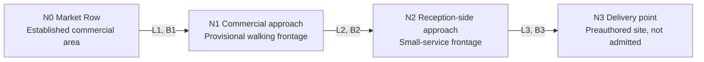

# Meridian Bay — Market Row delivery receiving point: one frontage section

**Status:** PREPARED-SITE DRAFT. **Not admitted to the playable world.**

The owner asked for one section at a time: link two established or prepared places, detail the in-between space, verify it and only then move to the next area. This document covers **only Market Row → the planned parcel receiving/collection point**. The preceding four inter-district corridors remain unchanged.

## Source authority

The preauthored Phase 1 catalog already defines `LOC-MARKET-DELIVERY-POINT` as a public-facing commercial receiving and pickup site attached to Market Row, but it is **not part of Jack's saved world state**. Its proposed reference coordinate is (57.6, 42.2); Market Row's area reference is (58, 43). Those are not measured street addresses.

Darius has an ordinary delivery role in the city, but **the catalog explicitly does not place any specific Darius delivery or recipient at this collection site**. The detail may not make such an assertion. The point has no confirmed staff schedule, packages, inventory, opening hours, exact doorway, street name, safe sidewalk or actual travel minutes.

## Only this in-between approach

The three path links are sketches, not new canonical city edges. They represent a candidate pedestrian approach between an existing district and a preauthored public-facing establishment. Every segment has two frontage-side descriptions; no individual building footprint, counter location, access gate or road crossing is declared. Both intermediate waypoints `MB-MD-N1` and `MB-MD-N2` are planning geometry **only**, not a playable `LOC-*` place.

## Review restrictions

- A prepared location must remain distinct from a visited or canonically admitted one.
- The validated source link is Market Row ↔ delivery point only; no new shortcut to Café Bruma, a cultural passage or Harbor Walk.
- The previous ten provisional corridor sketches must remain free of unregistered strict polyline crossings with this approach.
- The public-facing classification describes possible visitor access in principle, **not** whether the business is open, staffed, stocked, occupied or safe in a particular scene.
- No Darius delivery, NPC appearance, parcel transfer, character movement, imaginary minutes or saved-story change may be produced by this design file.
- Use [machine-readable draft](MERIDIAN_BAY_MARKET_DELIVERY_FRONTAGE_20261116.json), [read-only validator](../../tools/meridian_bay_market_delivery_frontage.mjs) and [targeted tests](../../tests/meridian_bay_market_delivery_frontage.test.mjs) before reviewing the next frontage.

After the tests pass, the next individual section is the **Market Row cultural passage**, then the **Market Row business offices**. After all three prepared storefronts are reviewed, independently audit the whole known urban-core map for connectivity, frontage placement, obstacles and contradictory views. That does **not** imply the entire fictional Meridian Bay municipality is fully drawn.

**Protected canonical checkpoint:** CH-000, turn 9, Day −29 morning. This proposal must remain in a separate draft PR with no `game/`, `chapters/`, journal or `main` writes.
