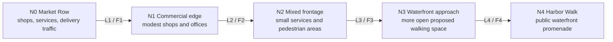

# Meridian Bay — Market Row → Harbor Walk direct corridor, detailed section

**Status:** DETAILED PROPOSAL, NOT CANONICAL STREET GEOMETRY. This is **one** section connecting two already established locations, fully elaborated in between before moving elsewhere.

The existing location graph lists both **Market Row ↔ Harbor Walk** and a separate path via **Crosswater Plaza**. Neither path may be deleted just to simplify the map. This proposal introduces no new location ID, discovered site, named business, or actual journey.

**Review sources:** [direct corridor data](MERIDIAN_BAY_MARKET_HARBOR_DIRECT_DETAIL_20261116.json), [read-only validator](../../tools/meridian_bay_market_harbor_direct.mjs), [eight targeted regression tests](../../tests/meridian_bay_market_harbor_direct.test.mjs). Built on previous Railgarden–Market Row, Market Row–Crosswater, and Crosswater–Harbor Walk detailed drafts. Checkpoint: **CH-000, turn 9, Day −29 morning**.

## One continuous corridor; details between endpoints

Every N1–N3 waypoint is a **geometry label**, not a canonical road junction or new place. The sketch uses reversible reference points on the existing 100×80 canvas: Market Row (58,43), (60,40.7), (64,38.1), (68,36.9), Harbor Walk (71,37). The provisional line was checked against the previously drafted links for strict unregistered interior intersections. Coordinates cannot establish actual distances, cardinal directions, sidewalks or legal access.

| Intermediate link | Proposed streetscape on both sides | What is still unverified |
|---|---|---|
| L1, F1 | Market-side shops, small services and offices | Exact storefronts, loading positions, road rights |
| L2, F2 | Mixed workday retail/service frontage | Building footprints, legal service crossings, footway width |
| L3, F3 | More open transition toward public waterfront | Coastline, barriers, slopes, building heights and visibility |
| L4, F4 | Public Harbor Walk frontage with working-port views | Promenade width, dock fencing, coastal obstacles, public access to separate port facilities |

The shop→waterfront character is a **proposed design**, not an unplayed event. Future NPC routines may depend on these contexts only after validated adoption, not from this draft.

## Saved story and distinct routes

The opening setting says **Market Row also connects to Harbor Walk**, independently of Crosswater Plaza. The chapter describes port lights over dark water beyond buildings and café access to visible terminal glow. The proposal must not place obstructions that contradict those facts. But no direct sightline has been surveyed or simulated, and Harbor Walk **does not authorize entrance** into controlled industrial or passenger-port facilities.

The draft route preview gives ordered, bidirectional geometry only. It cannot move Jack, advance time, add a location to the player's knowledge, place an NPC, or confirm travel minutes.

## Completion and next review

Run the validator/tests for this corridor **together with all three predecessor detail validators**, the entire Node.js and Python suites, and the canonical checkpoint validation. If checks pass, preserve the draft and mark the current basic connected-area corridors as **individually proposed and technically tested**, not as a finished, traversable or physically verified full city.

Only then begin a **separate full-map review** of connectedness, all established local storefront links, duplicate links and junctions, alignments, walking accessibility, building placement, urban-to-waterfront transitions, visibility, and whether additional neighborhood areas need details. Prioritize unresolved observations without inventing plot, terrain or facilities. Do not merge stacked drafts blindly, and do not alter `game/` or `chapters/` as part of this design pass.
