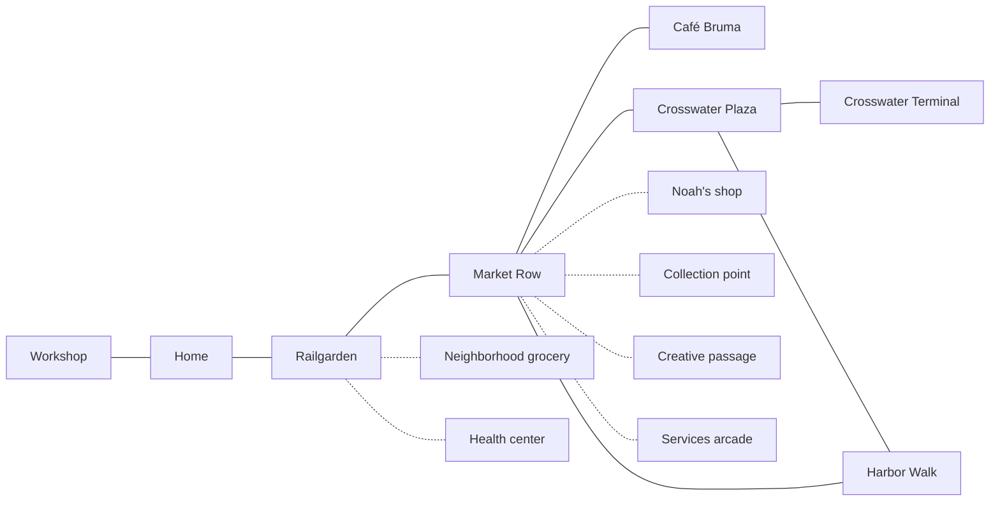

# Meridian Bay integration — Phase 1

This review increment combines the six-location design from PR #21 with the
route preview from PR #22 and the provisional layout from PR #23. Its baseline
is narrative commit `43a0e60013c69b1bf80abd36473264498d5363b7`. Source modules
were selectively adapted; the older turn engine, agendas and service systems
were not imported. The PR #33 code increment preserved every existing `game/`
and `chapters/` file. A later independent admission is a separate verified state
operation, as described below.

## What the integrated design contains

The [versioned catalog](MERIDIAN_BAY_PREBUILT_DESIGN.json) retains the original
six IDs and descriptions, with source provenance. It adds two public-facing
locations under Railgarden and four under Market Row. It supplies no opening
hours, employees, inventory, interior dimensions or automatic NPC encounters.

| District | Designed location | Stable ID |
|---|---|---|
| Railgarden | Neighborhood grocery | `LOC-RAILGARDEN-ABARROTES` |
| Railgarden | Neighborhood health center | `LOC-RAILGARDEN-CLINIC` |
| Market Row | Noah's repair and components shop | `LOC-MARKET-NOAH-REPAIR` |
| Market Row | Delivery collection point | `LOC-MARKET-DELIVERY-POINT` |
| Market Row | Creative passage | `LOC-MARKET-CULTURE-PASSAGE` |
| Market Row | Commercial-services arcade | `LOC-MARKET-BUSINESS-OFFICES` |

The graph below shows existing connections as solid lines and the six design
connections as dotted lines. It is a topology diagram, not a street map or a
distance estimate. After explicit admission the prepared graph has fourteen
`LOC-*` nodes and fourteen bidirectional links. The `CITY-*` container is never
a transit shortcut.

The [scale canvas](MERIDIAN_BAY_CITY_SCALE_PLAN_20261112.json) remains a
100 × 80 planning grid with a nominal 10 × 8 km study rectangle. Its positions,
district envelopes and uncharted reserves are proposals, not established city
measurements. Neither coordinate proximity nor canvas scale creates roads or
travel minutes. The [atlas crosswalk](MERIDIAN_BAY_ATLAS_PREBUILT_CROSSWALK_20261112.json)
preserves aliases separately from merely related proposals; it does not turn
the proposed delivery courtyard into the collection point. Elena's school
remains unmapped.

## Existence, knowledge, visits and access

These four states stay separate:

- **Design existence:** `prepareMeridianBayWorld` returns a detached copy with
  all six locations, independent of Jack's actions. This is not a saved world.
- **World admission:** a separate journaled `saveWorldAdmission` operation
  requires a reviewed design ID, the verified source commit, and an editorial
  reason. It pins the design without consuming a turn or changing played
  history. Ordinary turns never import it automatically.
- **Knowledge and visits:** a reviewed observation records structured evidence
  in a player knowledge event. Jack must have been at the location or its
  district frontage during that event, and the exact observation must appear
  in the linked transcript. An actual arrival is separately derived from a
  recorded movement; seeing the frontage does not constitute visiting it.
- **Current access:** a public-facing entrance does not establish that a
  business is currently open, staffed or providing services. Mutable conditions
  may support a private availability assessment; missing evidence remains
  unknown, and an observed entrance supplies no current opening knowledge.
  An entrance visit does not authorize a purchase, medical service or interior
  access.

Observation checks include archived chapters and reject remote sightings,
unlinked quotes, spoofed knowledge strings, and discoveries backdated before
design admission. Known-place inspection returns the actual source event IDs.
Route previews deliberately do not authenticate knowledge from state strings.

## Turn integration

The first-turn admission path originally proposed in PR #33 is superseded by
the [independent admission operation](WORLD_ADMISSION_AND_LOCATION_STATE.md).
`stageWorldAdmission` prepares the reviewed map, and `saveWorldAdmission`
persists it with a durable journal while preserving the current completed turn,
time, actors, chapter and all played history. The review marker's
`effective_from_turn` records that existing checkpoint, not a consumed new turn.

`stageMeridianBayTurn` is the gameplay bridge to the current living-world
coordinator after admission. It rejects an unadmitted map or an inline
`designReview`. Subsequent turns use the already admitted design without
reauthoring it.

`saveMeridianBayTurn` wraps that bridge in the existing five-file transaction
and requires a durable journal. A real turn still needs the player's action,
reviewed consequences, complete prose, literal archive and verified readback.
The city design exists before observation; its independent admission does not
manufacture a player event claiming Jack built or discovered all six locations.

The immutable design is accompanied by optional event-backed
`world.location_states` records for operating status, physical condition and
confirmed hours. A later closure or damaged building changes that state, not
the original catalog. See the same admission/location-state contract for the
schema and knowledge boundary.

Movement keeps current contextual estimates, route checks and time budgets.
The private route preview preserves directed existing links and explicit
waypoints. An unadmitted draft route cannot be used by an ordinary saved turn.
Optional `inspectLivingWorld({includeCityDesign:true,...})` exposes private
design and observation context. `playerVisibleDiagnostic` excludes that packet.

## Validation and remaining scope

The synthetic pipeline exercises admission → travel to Market Row → observation
without entry → interrupted save and literal recovery → separately chosen
entrance visit → CH-001 transition → recovery of both historical evidence IDs.
Tests also cover unchanged family state, routes with waypoints, unknown access,
altered designs, stale review sources, future locations outside the mapped
subset, and no automatic adoption during an ordinary turn. All scenes in these
tests are explicitly synthetic and kept in memory.

Publishing or testing the technical integration does not by itself activate
the six places. Promotion of the reviewed code/design and its first authorized
admission remain distinct from this QA; verify actual admission in the state
and journal. Admission at CH-000 turn 9 preserves Day -29 morning and the
pending player action. NPC needs, relationships, services, multi-day civilian
event chains and Day 0 remain later increments; none is implied by drawing
this map.
