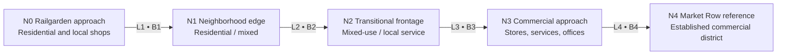

# Meridian Bay — detailed Railgarden → Market Row corridor (one-section review)

**Status:** **PROPOSED DESIGN, NOT CANONICAL MAP OR LIVE ROUTING**.  
**Scope:** Only the space **between Railgarden and Market Row**. No expansion to Crosswater/Harbor Walk in this work item.  
**Source of truth:** Existing `game/STATE.json` links and saved CH-000 story outrank every proposed line here.  
**Details:** [source-linked JSON plan](MERIDIAN_BAY_RAILGARDEN_MARKET_CORRIDOR_DETAIL_20261116.json), [read-only reviewer](../../tools/meridian_bay_rail_market_corridor.mjs), [regression tests](../../tests/meridian_bay_rail_market_corridor.test.mjs).

## Why work in individual sections

The owner specified: **connect two established places; develop the in-between space; verify this section; then proceed to the next pair.** Do not sketch a succession of bare links and call the city complete. A later **full-city review** checks how all finished sections form one coherent map, with access, obstacles and scale.

The first route sketch (MB-WEB-002 in PR #34) already has four polyline intervals. This increment develops **only those four** into a proposed corridor sequence. Their node coordinates are not georeferenced and are not literal junction survey points.

**Each link has an associated two-sided frontage band:** A and B are relative sides, not east/west or parcel boundaries.

| Detailed link | Intermediate area and design intention | Physical-access uncertainty |
| --- | --- | --- |
| L1 · Railgarden → neighborhood edge | Residential buildings and small neighborhood commerce; local sidewalk concept | Household/shop front doors and crossings not placed |
| L2 · neighborhood edge → mixed-use transition | Low-rise mixed frontage; gradual change from residential to commercial activity | Sidewalk continuity and crossings not physically validated |
| L3 · mixed-use transition → Market Row approach | Candidate service activity and working-day shop/office frontage | No assumed warehouse, delivery depot, loading bay or named business |
| L4 · Market Row approach → Market Row anchor | Existing shopping/office district, food stalls and ordinary delivery traffic as general texture | Noah's shop and Café Bruma remain separate location links, not assigned to this specific road |

The Railgarden grocery, clinic, Wilson residence, Noah's repair shop and Café Bruma have their own **separate existing or draft district connections**. This corridor does not invent intersections or relocate storefronts to its centerline. The Wilson workshop remains **inside the residence**.

## Narrative constraint: Jack's return home

The archived chapter describes the city's shop/office facades giving way to Railgarden's residential buildings before Jack reaches home. In this sketch, the land-use descriptions reflect that **existing scene**, with a progressively more residential feel toward Railgarden. This is a proposed coherent design, not a reconstructed exact route or new Jack action.

## What is actually specified

- Five ordered planning nodes (`MB-RM-N0` to `MB-RM-N4`) that match the **existing** candidate polyline.
- Four continuous links (`MB-RM-L1` to `MB-RM-L4`), each with a provisional street character, pedestrian edge concept, access caveat and unknown traffic flow/time.
- Four frontage bands (`MB-RM-B1` to `MB-RM-B4`) describing both relative sides and emphasizing unknown building footprints.
- A read-only path preview in both directions, a check against the source city graph and actual transcript wording, and hard safeguards against story movement or new canonical locations.

## What must remain unresolved

This is **not** a surveyed street layout. The exact district boundaries, widths, lanes, individual building plots, storefront doors, crosswalks, accessible paths, public/private rights of way, building heights, actual traffic direction, bus stops, road names and realistic travel times are still unknown. Proposed pedestrian continuity is not accessibility certification. No new NPCs, encounters or businesses were established by this sketch.

## Review order and handoff

1. Verify `MB-WEB-002` is still an existing Railgarden ↔ Market Row link in the saved graph; verify planning points and literary return route match.
2. Check every node and intermediate link is connected **without introducing any additional topological edge** or secretly making a geometry node into a `LOC-` place.
3. Review both frontage sides, ordinary activity character and pedestrian-access uncertainty for all four intervals.
4. Run targeted tests, full JS/Python regression suite and canonical save validator. Record real CI evidence before calling this increment technically verified.
5. Keep the details in an isolated draft branch. **Do not merge or activate the map without resolving review/branch dependencies.**
6. Only after completing this section move to the **Market Row → Crosswater Plaza** *detail stage*. That previously drafted bare connector (PR #36) is not proof its intervening street blocks are finished. Repeat the connect → detail → verify process.
7. When all sections are authored, perform a **separate full-city routing/obstruction/consistency review** and revise weak transitions. Avoid describing the city as complete before that review.

This document does not update `game/`, `chapters/` or the player's saved journal. The last verified story remains CH-000, turn 9, Day -29 morning. Story choices and the NPC roster are separate work tracks.
