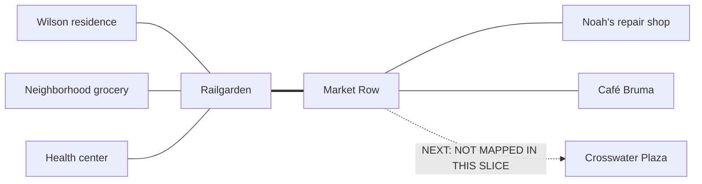

# Meridian Bay road web — incremental mapping slice 1 (2026-11-16)

**Status:** PROPOSED / NOT ADMITTED / NOT CANONICAL STREET GEOMETRY  
**Independent branch:** `work/meridian-bay-road-growth-slice1-20261116`, based on the unmerged Meridian Bay Phase 1 PR #33.  
**Data:** [first-slice street geometry](MERIDIAN_BAY_ROAD_WEB_SLICE1_20261116.json)  
**Validator:** [read-only road review](../../tools/meridian_bay_road_web.mjs)  
**Tests:** [road-web regression](../../tests/meridian_bay_road_web.test.mjs)

## Goal and constraints
Grow the map as a connected web **from a known point**, reviewing each connection before adding more. Do not design the full city, all NPCs, story arcs, and buildings simultaneously. This is a **physical road/pedestrian sketch**, separate from the later narrative choice-branching tree.

Starting point: **Railgarden** (`LOC-RAILGARDEN-RESIDENTIAL`). The Wilson home is connected to Railgarden. Market Row is already connected to Railgarden in the canonical graph. Draft Phase 1 contains the six public-facing establishments but they are not in Jack's live checkpoint.

First map slice:

The workshop is **inside** the Wilson residence and must not become a separate street intersection. The grocery, health center and Noah's shop are preauthored **draft** places; the café and residential/home anchors have existing story identities. The diagram is a **connectivity proposal**, not a measured aerial map.

## Work performed in this slice
1. Use the existing city grid, reference anchors and the saved/Phase 1 link graph as constraints. Preserve all original location IDs and edges.
2. Sketch the Railgarden ↔ Market Row corridor on the provisional 100 × 80 grid using explicit turns. This is a **candidate physical alignment** along an existing topological connection; it does not create an extra shortcut.
3. Add exactly five adjacent frontage/sidewalk sketches: Wilson residence, Railgarden grocery, Railgarden health center, Noah's shop and Café Bruma. They connect only to their parent district.
4. Keep six distinct, bidirectional **proposed** segments across seven anchors. Verify that each segment matches two reciprocal edges in the prepared world, fits the core planning envelope, has plausible relative detour and that all seven anchors are connected in this small sketch.
5. Treat geometry as hypothetical because the city's exact boundaries, street rights-of-way, obstructions, traffic direction, coastline, physical buildings, travel times and opening hours have **not** been surveyed or defined. Road names are also unset.
6. Never convert a line on this map into a player discovery, a verified route time, a purchase, an NPC event or canonical state change.

## Why this matters
The original world graph says which locations can be reached from each other; it does **not** describe sidewalks and street geometry. This mapping increment adds a possible spatial depiction **while retaining the original graph as authority**. A reader-facing narrative should not claim that any particular street, detour, distance or shop opening was discovered just because this draft exists.

A planned route from Wilson residence to Café Bruma follows Wilson residence → Railgarden → Market Row → Café Bruma. A planned route from the Railgarden grocery to Noah's shop follows grocery → Railgarden → Market Row → Noah. The read-only viewer returns these paths as **draft planning**, not actual player travel.

## Next expansion — one new area at a time
1. Review the first corridor with the owner and reconcile any physical geography, blocks, access issues or additional buildings without rewriting played events.
2. Next choose the **Market Row ↔ Crosswater Plaza** connection, which already exists in the topological graph, then draw its local intersection shapes and verify against the market and transit context.
3. Only afterward map Crosswater Terminal/Harbor Walk and additional districts. Do not invent an industrial port, an Elena-school position or future unnamed residential neighborhoods to fill whitespace.
4. NPC rosters, businesses and activities must be tied to locations when those locations have sufficient design authority. Choice/event branch authoring comes later; the draft plan in `docs/04_story/FUTURE_NARRATIVE_BRANCHING_PLAN.md` is separate from physical roads.
5. If the owner later prefers an interactive **RPG** rather than the currently authoritative **interactive-novel** contract, reconcile that format decision deliberately before adding RPG mechanics, menus, numerical stats or a game runtime.

## Acceptance criteria
- Every first-slice connection uses an already verified location-graph edge, with no invented physical shortcut.
- The sample routes are connected and have no isolated node or road crossing outside the study region.
- The proposal and its validator cannot move Jack, initialize NPCs, advance time or edit the saved checkpoint.
- Missing graph authority fails closed.
- QA tests and narrative checkpoint validator pass on a draft PR before any adoption into the playable branch.
- A reviewer can find this file, the JSON, and the future expansion queue from the world index.

**Important:** A successful test validates internal graph and sketch consistency, **not** real-world street feasibility or evidence that Meridian Bay has been completely mapped. All unsurveyed geometry is provisional.

**Canonical checkpoint preserved:** CH-000, turn 9, Day -29 morning. World admission, live-turn save authorization and Day 0 remain separate.
