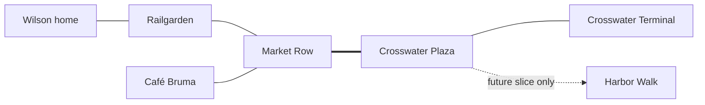

# Meridian Bay road web — incremental slice 2: Market Row to Crosswater

**Recorded:** 2026-11-16  
**Status:** DRAFT / PROVISIONAL / NOT ADMITTED AS CANON  
**Depends on:** [Slice 1](MERIDIAN_BAY_ROAD_WEB_SLICE1.md), which is based on Meridian Bay Phase 1 draft PR #33.  
**Machine-readable proposal:** [Slice 2 JSON](MERIDIAN_BAY_ROAD_WEB_SLICE2_20261116.json)  
**Validation:** [Read-only geometry checker](../../tools/meridian_bay_road_web_expansion.mjs); [regression tests](../../tests/meridian_bay_road_web_expansion.test.mjs).

## Chosen next growth point

Build **only** the already established Market Row → Crosswater Plaza connection, then Crosswater Plaza → its adjacent transit terminal entrance. Existing story locations, local draft businesses, and the six reviewed Slice 1 segments stay unchanged.

**New draft segment MB-WEB-007:** Market Row (58,43) → illustrated waypoints (59.8,42.6), (62.2,42.3), (64,42.1) → Crosswater Plaza (65,42). The line describes a proposed pedestrian-capable connecting corridor, not a fixed street, traffic pattern, or travel time.

**New draft segment MB-WEB-008:** Crosswater Plaza (65,42) → Crosswater Terminal (66,42). These are preexisting neighbors, but the dimensions and entrance orientation are not surveyed.

Together with Slice 1, this produces **eight proposed connected segments across nine existing or Phase 1 designed location anchors**. No new locations or canonical adjacency links are created.

## Original story alignment and unresolved geometry

The saved Chapter CH-000 transcript establishes that Jack left Crosswater for Market Row, where Café Bruma occupies a corner. From there, the terminal's glow was still perceptible. The map can preserve the route order and acknowledge the visible light, but **does not have sufficient building, facade, light-reflection or elevation geometry to prove a direct clear line of sight**. A future building-massing pass must not block the established light observation without a credible reflected or indirect view.

The story also establishes Jack's return from Market Row to Railgarden and the Wilson home. The earlier graph and mapped corridor retain that order. No player or NPC follows these newly drawn lines just because this proposal exists.

## Fail-closed verification

`validateMeridianBayRoadExpansion` first validates Slice 1 and the original story crosswalk. It then confirms the two new pairs are already reciprocal in the saved world graph; all waypoints are within the provisional city core; no zero-length or exceptionally circuitous sketches appear; all nine mapped anchors are connected; and no two sketched segments create an unregistered interior crossing.

`previewMeridianBayExpandedWeb` can show a **draft** connectivity sequence from Crosswater Plaza to Wilson home or from the terminal to Café Bruma. It always marks actual travel, fictional-time progression, new knowledge, sightline verification and world admission as **not performed**.

This check cannot establish physical sidewalks, traffic legality, distances, building footprints, property borders or the real shape of Meridian Bay.

## What comes next

After review and successful CI, the next increment may consider the **Crosswater Plaza → Harbor Walk** public connection. That requires checking the actual story's harbor view and the coastal obstacles before drawing a waterfront road. The **Market Row → Harbor Walk** direct connection is a separate edge that must not be collapsed into an invented shortcut via Crosswater.

The NPC roster, building backends and interactive choice-branch architecture are separate follow-up stages. This road work is not their implementation. Do not alter `game/`, `chapters/`, `main` or any live save; Jack remains at CH-000 turn 9, Day -29 morning until the player acts through the verified journaled narration flow.
